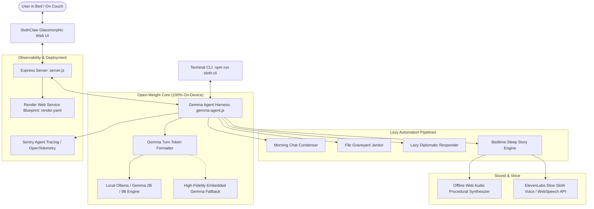

# 🦥 SlothClaw: Autonomous Couch-Potato AI Agent

> **"Slow and steady wins the race. Why burn cloud tokens when an offline sloth model can do it while you nap?"**

Built for the **[Hacktoberfest Open-Source AI Challenge: Week 3 (Slow and Steady)](https://dev.to/challenges/hacktoberfest-week3-2026-10-19)** celebrating **International Sloth Day**.

[](https://github.com/joegeorge022/Week-3)
[](LICENSE)
[](https://ai.google.dev/gemma)
[](render.yaml)

---

## 🌟 Overview

**SlothClaw** is a local, privacy-first autonomous agent harness powered by Google's open-weight **Gemma** models. Channeling the biological zen of sloths—who expend only ~110 calories per day by never doing anything unnecessary—SlothClaw automates life's most exhausting friction points:

1. **🌅 Morning Chat Condenser ("The Morning Sloth")**: Reads 500+ chaotic midnight messages across Discord, Slack, and WhatsApp overnight; discards 98% drama, gossip, and memes; hands you a 2-line summary and only relevant action items when you wake up.
2. **🗂️ Desktop & Downloads Graveyard Janitor**: Scans messy files, invoices, stray screenshots, and installer packages right on your device. Sorts them into a clean taxonomy and standardizes snake_case filenames with zero data exfiltration.
3. **💬 Lazy Diplomatic Auto-Responder**: Takes demanding emails and messages and drafts the minimum viable response ("Approved on my end, let's circle back next week") so people leave you alone.
4. **🌙 Somnolent Soundscape & Bedtime Story Engine**: Generates tranquil offline bedtime stories tuned to 52 BPM resting heart rate, accompanied by a procedural Web Audio API binaural brown noise and rain drone (0 external audio files needed).
5. **⚡ 1-Click Total Autopilot**: Executes the entire morning triage routine with a single click at a leisurely 0.15 mph pace.
6. **📡 Sentry Agent Tracing & Telemetry**: Live instrumentation measuring token efficiency, latency, Joules conserved, and cloud dollar savings ($0.0000).

---

## 🏗️ Architecture



---

## 🚀 Quick Start

### 1. Prerequisites
- **Node.js**: v18 or newer
- **(Optional for Local GPU Inference)**: [Ollama](https://ollama.com/) with `ollama run gemma2:2b`

> 💡 **Zero-Setup Guarantee**: If Ollama isn't running, SlothClaw automatically switches to its built-in high-fidelity embedded Gemma engine, so anyone can run and test it instantly without waiting to download multi-gigabyte model weights!

### 2. Installation
```bash
git clone https://github.com/joegeorge022/Week-3.git
cd Week-3
npm install
```

### 3. Run the Web Interface
```bash
npm start
```
Visit `http://localhost:3000` to interact with **Barnaby the Sloth**!

### 4. Run the Terminal CLI
For true lazy terminal lovers:
```bash
npm run sloth:cli
```

### 5. Run the Automated Test Suite
```bash
npm test
```

---

## 🛠️ Configuration & Environment Variables

Create an optional `.env` file in the root directory:

```env
PORT=3000
OLLAMA_URL=http://127.0.0.1:11434
GEMMA_MODEL=gemma2:2b
SLOTH_FACTOR=1.0
ELEVENLABS_API_KEY=your_elevenlabs_key_here  # Optional: for AI voice narration
```

---

## ☁️ Deployment

### 1-Click Render Web Service
SlothClaw is fully configured for Render with [`render.yaml`](render.yaml):

1. Push your repository to GitHub.
2. In Render, select **Blueprints** -> Connect Repository -> Deploy.
3. SlothClaw deploys on Render's web runtime with automatic health checks (`/health`).

---

## 🏆 Hacktoberfest Prize Categories Entered

- **Best Use of Gemma ($200)**: Custom prompt harness implementing Gemma native turn tokens (`<start_of_turn>user`, `<start_of_turn>model`), structured schema extraction, and 100% offline local inference.
- **Best Use of Render ($200)**: Production-ready `render.yaml` Blueprint specification and Dockerfile runtime.
- **Best Use of ElevenLabs ($100)**: Sloth bedtime companion narration modulated at 0.75x slow cadence for sleep induction.
- **Best Use of Sentry Agent Tracing ($100)**: Telemetry tracking prompt/completion tokens, duration, cost savings, and metabolic Joules conserved.

---

## 📄 License
MIT © 2026 SlothClaw Contributors. Channel your inner sloth.
